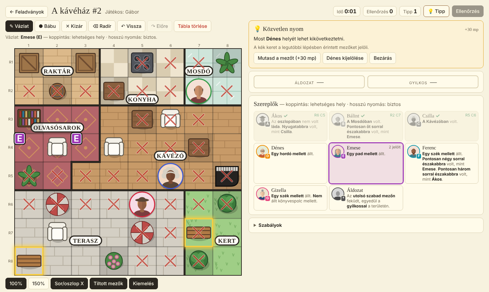
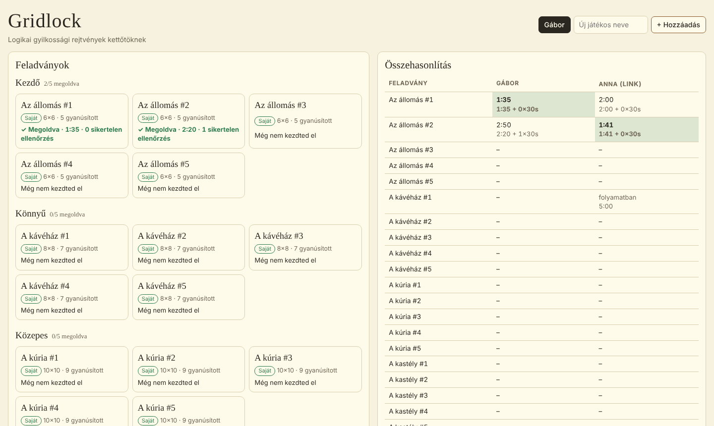

# Gridlock 🔎

**Logikai gyilkossági rejtvények kettőtöknek: stopperrel, tippekkel és párbajjal.**

▶️ **Játék:** https://havasig.github.io/gridlock-mistery/



Tisztán statikus weboldal: nincs szerver, nincs fiók, nincs adatbázis. Telefonon és gépen is működik, és a kezdőképernyőre téve appként indul.

A játékmenetet Manuel Garand [Murdoku](https://murdoku.com) feladványai ihlették. Minden itt szereplő feladvány saját készítésű, a projekt nem kapcsolódik a Murdokuhoz.

---

## A játék

Egy helyszínen gyilkosság történt. A térkép területekre (szobákra) van osztva, a mezőkön tárgyak vannak. Minden gyanúsítottról tudsz egy-két nyomot, és ezekből kell kikövetkeztetned, ki hol állt, és ki a gyilkos.

### Szabályok

1. **Minden sorban és minden oszlopban pontosan egy szereplő áll** (a gyanúsítottak és az áldozat).
2. **„Mellett”**: közvetlenül fölötte, alatta, balra vagy jobbra (átlósan nem), **ugyanabban a területben**.
3. **„Északabbra”**: feljebb lévő sorban, bármelyik oszlopban. **„Nyugatabbra”**: balrább lévő oszlopban.
4. Senki nem állhat **nem foglalható tárgyon** (fa, asztal, polc, hordó…). Székre és padra lehet ülni.
5. Az **áldozat az utolsó szabad mezőn** fekszik, és a területén **pontosan egy gyanúsított** volt vele: ő a gyilkos.

### Szintek

| Szint | Helyszín | Rács | Gyanúsított | Feladvány |
|---|---|---|---|---|
| Kezdő | Az állomás | 6×6 | 5 | 5 |
| Könnyű | A kávéház | 8×8 | 7 | 5 |
| Közepes | A kúria | 10×10 | 9 | 5 |
| Nehéz | A kastély | 12×12 | 11 | 5 |

Minden feladványnak **pontosan egy megoldása** van, és mindegyik megoldható pusztán logikával, tippek követésével is (gépi ellenőrzéssel igazolva).

---

## Kezelés

| Eszköz | Mit csinál |
|---|---|
| **✎ Vázlat** (alap) | Válassz szereplőt a listából. **Koppintás**: lehetséges hely (kis betű a mezőben). **Húzás nyomva tartva**: több mezőre egyszerre (ha betűs mezőről indulsz, töröl). **Hosszú nyomás**: biztos hely, lerakja a bábut. Lerakott bábun hosszú nyomás: leveszi. |
| **● Bábu** | Egy kattintással lerak, a bábura kattintva leveszi. |
| **✕ Kizár** | X a mezőre, húzással több mezőre is. Az X a mező vázlatbetűit törli. |
| **⌫ Radír** | Jelölés, betű vagy bábu törlése. |
| **↶ Vissza / ↷ Előre** | Visszavonás és újra végrehajtás (Ctrl+Z, Ctrl+Y). |

Segítségek (a térkép alatt ki- és bekapcsolhatók):
- **Sor/oszlop X**: egy lerakott bábu sorát és oszlopát végig kiX-eli.
- **Tiltott mezők**: a nem foglalható tárgyak enyhén szürkék, az X csak rámutatáskor jelenik meg.
- **Kiemelés**: a kijelölt szereplő nyomában szereplő tárgyakat és területeket kiemeli.
- A kijelölt szereplő betűi nagyobbak, a lerakott szereplők a listában szürkék ✓-val, és ha kijelölsz egy lerakottat, a bábuja villog a térképen.

---

## Pontozás és verseny

- **Stopper:** csak akkor megy, ha a feladvány nyitva van és az oldal látszik.
- **Ellenőrzés:** csak akkor lehet, ha mindenki le van rakva. Megmondja, hány bábu áll rossz helyen.
- **💡 Tipp:** megmutatja a következő logikai lépést és a technika nevét, kérésre a pontos mezőt is. Ha valaki rossz helyen áll, először ezt jelzi.
- **Pontidő** = idő + 30 mp × (sikertelen ellenőrzések + tipp-lépések). Feladványonként a kisebb pontidő nyer.

### Eredmények összevetése



Az **Eredményeim küldése** gomb vágólapra másol egy rövid összefoglalót, amit Messengerbe lehet illeszteni:

```
🔎 Gridlock — Gábor
A kúria #1 megoldva ⏱ 6:52 · 1 hibás ellenőrzés

Kezdő    🟩🟨⬜⬜⬜
Könnyű   ⬜⬜⬜⬜⬜
Közepes  🟨⬜⬜⬜⬜
Nehéz    ⬜⬜⬜⬜⬜

3/20 megoldva · össz. pontidő 11:12
https://havasig.github.io/gridlock-mistery/#r=…
```

🟩 hibátlan · 🟨 hibával vagy tippel · ⬛ folyamatban · ⬜ nincs elkezdve

Ha a másik megnyitja a linket (vagy beilleszti az egész üzenetet a „Kapott link beillesztése” mezőbe), az eredményeid bekerülnek az ő összehasonlító táblázatába. Ha egy eszközön játszotok, nem kell semmit küldeni.

### Folytatás másik eszközön

**Haladás átvitele linkkel**: az eszközön lévő teljes haladást (bábuk, jelölések, idő, minden játékos) egy linkbe csomagolja. Ezt megnyitva a másik eszközön ott folytathatod, ahol abbahagytad. Ahol mindkét helyen van haladás, a frissebb vagy a megoldott marad meg. Biztonsági mentésnek van **Mentés fájlba** és **Betöltés fájlból** is.

---

## Megoldási technikák (a Tipp ezeket használja)

| Technika | Lényege |
|---|---|
| **Közvetlen nyom** | A nyom egyetlen mezőt enged meg. |
| **Sor és oszlop** | Egy biztos szereplő sora és oszlopa mindenki más elől kiesik. |
| **Rejtett egyes** | Egy sorba vagy oszlopba már csak egyvalaki kerülhet, tehát ott van. |
| **Viszonylagos nyom** | „Északabbra”, „pontosan *n* sorral”, „ugyanabban a területben”: a két szereplő jelöltjei kölcsönösen szűkítik egymást. |
| **Zárt csoport** | *k* szereplő csak ugyanabba a *k* oszlopba vagy sorba kerülhet, így azokat ők foglalják el. |
| **Áldozat-szabály** | Az áldozat területén pontosan egy gyanúsított van. Ahol ez nem teljesülhet, ott nincs az áldozat. |
| **Ellentmondás** | „Ha X itt lenne, Y-nak nem maradna helye”, tehát X nincs ott. |

---

## Közzététel és helyi futtatás

GitHub Pages: **Settings → Pages → Deploy from a branch → `master` / root**. Minden push után 1–2 perc alatt frissül.

Helyben:
```
python -m http.server 8000
```
majd http://localhost:8000

## Fájlok

| Fájl | Tartalom |
|---|---|
| `index.html` | A teljes alkalmazás (felület, rajzolás, mentés, megosztás). |
| `puzzles.js` | Térképek, szereplők, nyomok szövege és szerkezete (`rules`), a megoldások csak SHA-256 lenyomatként. |
| `hint.js` | A tippmotor: jelöltlisták szűkítése, lépésenkénti magyarázattal. |
| `favicon.svg`, `apple-touch-icon.png` | Ikonok. |
| `og-image.png` | Link-előnézet képe (Messenger, Facebook stb.). |
| `docs/` | Képernyőképek ehhez a leíráshoz. |

### Adattárolás

Minden adat a böngésző `localStorage`-ában van, eszközönként. Ablak bezárása vagy újraindítás után is megmarad. Elveszhet viszont böngészési adatok törlésekor, privát ablakban, illetve iPhone Safariban 7 nap használat nélkül. Utóbbi ellen segít, ha kezdőképernyőről indítod az oldalt. Másik eszközre az átviteli link vagy a mentésfájl viszi át.

### Új feladvány hozzáadása

A `puzzles.js` `puzzles` tömbjébe kell egy új elem: `id` (`<térkép>-<sorszám>`), `map`, `title`, `difficulty`, `people` (név, nyomszöveg, kiemelési kulcsok), `rules` (a nyomok szerkezete, ezt használja a tipp) és `check` (a megoldás mezőinek lenyomata: `sha256("<id>|<név>|<sor>,<oszlop>")` első 20 hexa karaktere). Új térkép a `maps` objektumba kerül: méret, területek soronként, területnevek és tárgyak. Fontos, hogy a feladványnak pontosan egy megoldása legyen.
